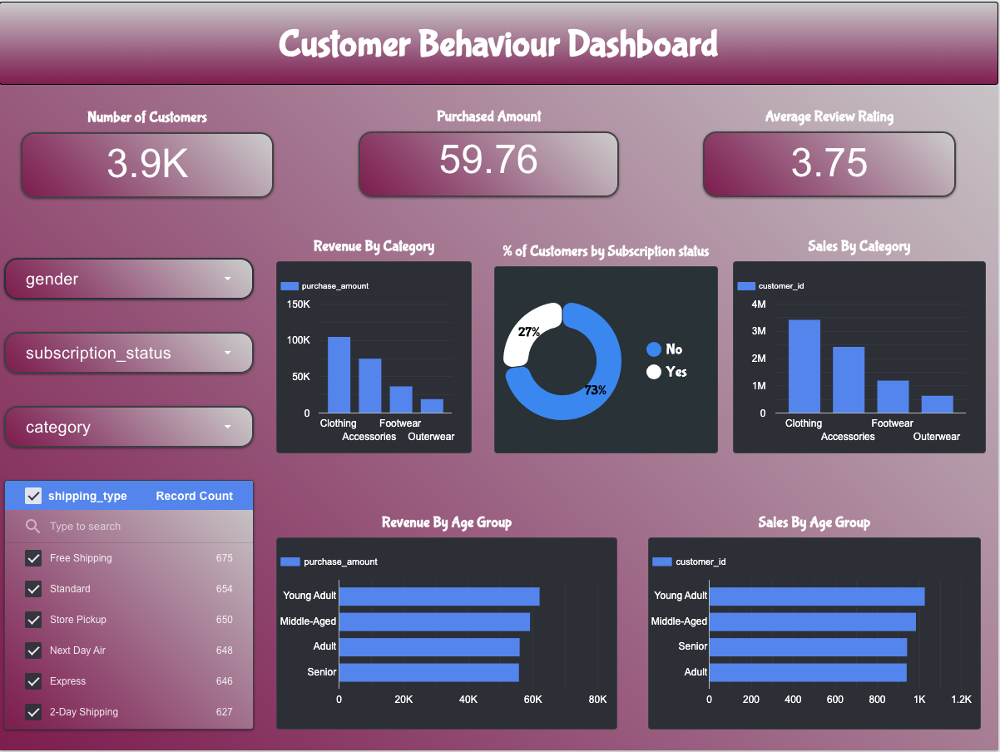

# Customer Shopping Behavior Analysis


An end-to-end data analytics project that turns 3,900 customer shopping records into business insights, using Python, PostgreSQL, Looker Studio, and a presentation deck.

---

## Overview

This project follows the full analytics workflow: loading and exploring data, cleaning it, querying it with SQL, visualizing it in an interactive dashboard, and presenting the findings.

**Business questions answered:**

- Which product categories generate the most sales?
- Which age groups spend the most?
- What share of customers are subscribers?
- Which shipping methods do customers prefer?

---

## Dataset

| | |
|---|---|
| **File** | `cleaned_customer_behavior.csv` |
| **Size** | 3,900 rows, one per customer purchase record |

| Group | Columns |
|---|---|
| Customer | `age`, `age_group`, `gender`, `location` |
| Purchase | `category`, `item_purchased`, `purchase_amount`, `season`, `color`, `size` |
| Engagement | `subscription_status`, `discount_applied`, `previous_purchases`, `purchase_frequency_days`, `review_rating` |
| Fulfillment | `shipping_type`, `payment_method` |

---

## Tools

| Stage | Tool | Used for |
|---|---|---|
| Data loading, EDA, cleaning | **Python** (Pandas, Jupyter Notebook) | Exploring and preparing the data |
| SQL analysis | **PostgreSQL** (pgAdmin 4) | Business queries on the cleaned data |
| Dashboard | **Looker Studio** | Interactive visuals and KPIs |
| Presentation | **Google Slides / PDF** | Slide deck for stakeholders |
| Version control | **Git / GitHub** | Project hosting |

---

## Project Steps

1. **Load & explore (Python):** Loaded the dataset with Pandas and ran exploratory data analysis: structure, data types, missing values, and summary statistics.
2. **Clean & prepare (Python):** Standardized column names, handled missing values, and engineered features such as `age_group` and `purchase_frequency_days`. Exported the result as `cleaned_customer_behavior.csv`.
3. **Query with SQL (PostgreSQL):** Loaded the cleaned data into a database and wrote queries for revenue by age group, category performance, subscription share, and shipping type counts.
4. **Build the dashboard (Looker Studio):** Created a dashboard with KPI cards and breakdowns by category, age group, subscription status, and shipping type.
5. **Report & presentation:** Summarized the findings in a presentation deck and documented the workflow in this repository.

---

## Dashboard



**What's inside:**

- **KPI cards:** total customers, purchase amount metric, average review rating
- **Category view:** Clothing, Accessories, Footwear, Outerwear
- **Age group view:** Young Adult, Middle-Aged, Adult, Senior
- **Subscription view:** subscribers vs. non-subscribers
- **Shipping view:** Free Shipping, Standard, Store Pickup, Next Day Air, Express, 2-Day Shipping

---

## Results

| Metric | Value |
|---|---|
| Total customers | **3,900** |
| Purchase amount metric | **59.76** |
| Average review rating | **3.75 / 5** |

**Key insights**

- **Clothing is the top category**, leading in both sales and order volume, followed by Accessories, Footwear, and Outerwear.
- **Young Adults are the strongest age segment**, with the highest revenue and customer count, closely followed by Middle-Aged customers.
- **Most customers are not subscribers:** 73% non-subscribers vs. 27% subscribers.
- **Shipping preferences are evenly spread**, led slightly by Free Shipping (675) and Standard (654).

**Recommendations**

- Promote loyalty or subscription perks to convert more non-subscribers.
- Focus marketing on Clothing and Accessories, and on Young Adult and Middle-Aged customers.
- Keep free and standard shipping prominent, since they are the most used options.

---

## Project Structure

```text
customer_shopping_behavior_analysis/
├── Customer_Shopping_Behavior_Analysis.ipynb
├── cleaned_customer_behavior.csv
├── customer_behavior_sql_queries.sql
├── dashboard_overview.png
├── LICENSE
└── README.md
```
## How to Run
1. Clone the repository
git clone https://github.com/DanishShameer/customer_shopping_behavior_analysis.git
cd customer_shopping_behavior_analysis

2. Run the Python analysis
pip install pandas numpy matplotlib seaborn jupyter
jupyter notebook Customer_Shopping_Behavior_Analysis.ipynb

3. Run the SQL queries
Create a database in PostgreSQL and import cleaned_customer_behavior.csv into a table (for example with the pgAdmin import tool).
Open and run customer_behavior_sql_queries.sql.

4. View the dashboard
Open dashboard_overview.png in this repository or view the report in Looker Studio.

## Author
Danish Shameer: [GitHub](https://github.com/DanishShameer)
